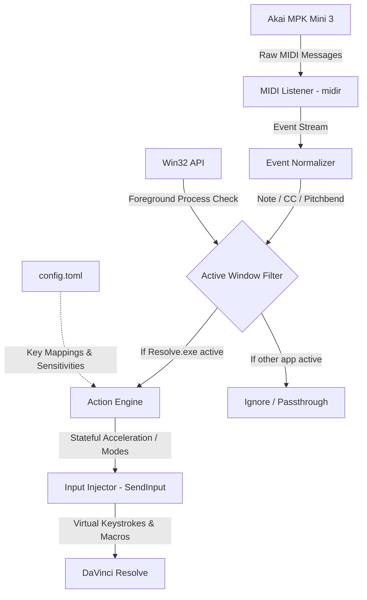

# Implementation Plan: `resolve-mpk` (Akai MPK Mini → DaVinci Resolve Bridge)

## 1. Executive Summary & Rationale for Rust
- **Target Audience:** Video editors & content creators using DaVinci Resolve with an Akai MPK Mini Mk3.
- **Why Rust:**
  - **Single Portable Binary:** Produces a standalone `resolve-mpk.exe` (~2–4 MB) with zero runtime dependencies (no Python, interpreters, or system drivers needed for end users).
  - **Zero Latency:** MIDI event processing and Win32 `SendInput` execution take <1ms, critical for responsive frame-by-frame jog scrubbing.
  - **Resilient Auto-Reconnection:** Safe concurrency to handle USB disconnects, laptop sleep, and hot-plugging without crashing.
  - **User Configurable:** Ship with default mappings baked in, with optional overrides via an external `config.toml`.

---

## 2. System Architecture



---

## 3. Modular Code Structure

```
resolve-mpk/
├── Cargo.toml                  # Dependencies & release profiles (LTO, opt-level = 3)
├── config.toml                 # User-editable mappings and sensitivities
└── src/
    ├── main.rs                 # CLI entry point, signal handling, lifecycle
    ├── config.rs               # TOML parsing & default mapping definitions
    ├── midi/
    │   ├── mod.rs              # Device auto-discovery & connection manager
    │   └── events.rs           # MIDI parser (Notes, CC relative/absolute, Pitchbend)
    ├── window/
    │   └── mod.rs              # Win32 foreground window detection (Resolve.exe)
    ├── engine/
    │   ├── mod.rs              # Action dispatcher and state machine
    │   ├── jog.rs              # Rotary acceleration logic for Knob 1 (Jog/Scroll)
    │   └── modes.rs            # Mode management (Speed Editor vs Color Page)
    └── input/
        └── win32.rs            # Raw SendInput wrapper for keystrokes and key combinations
```

---

## 4. Hardware Mapping Specification

### 4.1. Mode 1: Speed Editor Mode (Cut & Edit Pages)

#### Knobs & Joystick (Search Dial Emulation)
| Control | MIDI Input | Behavior | Resolve Action | Keystroke |
| :--- | :--- | :--- | :--- | :--- |
| **Knob 1** | CC 11 | **Jog Wheel** (Dynamic Acceleration) | 1 click = 1 frame; Fast flick = 5–15 frames | `←` / `→` |
| **Knob 2** | CC 12 | **Timeline Zoom** | Zoom In / Out | `Ctrl + =` / `Ctrl + -` |
| **Knob 3** | CC 13 | **Clip Navigation** | Jump Previous / Next Edit | `Up` / `Down` |
| **Joystick (X-Axis)** | Pitchbend | **Shuttle Controller** | Spring-loaded playback speed (center = pause) | `J` / `K` / `L` |
| **Joystick (Y-Axis)** | CC 1 / Mod | **Volume / Track Height** | Quick audio level or track adjustment | Custom |

#### Drum Pads (Speed Editor Transport & Edit Keys)
| Pad (Bank A) | Action | Key Combination | Purpose |
| :---: | :--- | :--- | :--- |
| **Pad 1** | **Mark In** | `I` | Sets in-point |
| **Pad 2** | **Mark Out** | `O` | Sets out-point |
| **Pad 3** | **Split / Blade** | `Ctrl + \` | Instant cut at playhead |
| **Pad 4** | **Ripple Delete** | `Shift + Backspace` | Deletes selected clip & closes gap |
| **Pad 5** | **Smart Insert** | `F9` | Inserts source into timeline |
| **Pad 6** | **Ripple Overwrite**| `Shift + F10` | Overwrites and auto-ripples |
| **Pad 7** | **Append to End** | `Shift + F12` | Places clip at the end of timeline |
| **Pad 8** | **Source / Timeline**| `Q` | Toggles Source Tape vs Timeline Viewer |

| Pad (Bank B) | Action | Key Combination | Purpose |
| :---: | :--- | :--- | :--- |
| **Pad 9** | **Trim In** | `[` | Selects in-point for trimming |
| **Pad 10** | **Trim Out** | `]` | Selects out-point for trimming |
| **Pad 11** | **Add Transition** | `Ctrl + T` | Default cross dissolve |
| **Pad 12** | **Toggle Snapping** | `N` | Turn magnet snapping on/off |
| **Pad 13** | **Fullscreen** | `Ctrl + F` | Toggle Cinema viewer |
| **Pad 14** | **Undo** | `Ctrl + Z` | Undo last operation |
| **Pad 15** | **Redo** | `Ctrl + Y` | Redo last operation |
| **Pad 16** | **Mode Switch** | Internal | Toggles between Edit and Color modes |

---

### 4.2. Mode 2: Color Panel Mode (Color Page)

When switched to Color Mode:
- **Knobs 1–8:** Directly adjust primary grading sliders (Contrast, Pivot, Midtone Detail, Shadows, Highlights, Saturation, Temp, Tint).
- **Pads:** Toggle Grade Bypass (`Shift + D`), Node Add (`Alt + S`), Previous Node (`Shift + Prev`), Next Node (`Shift + Next`).

---

## 5. Key Technical Implementation Details

### 5.1. Rotary Acceleration Algorithm (Jog Dial Feel)
Endless encoders send discrete step values. To make Knob 1 feel like a weighted hardware search dial:
- Calculate delta time $\Delta t$ between consecutive CC ticks:
  $$\text{Frames To Step} = \max\left(1, \; \text{round}\left(\frac{\text{Sensitivity}}{\Delta t}\right)\right)$$
- Micro-movements step single frames cleanly.
- Quick continuous spins scrub seconds of footage smoothly.

### 5.2. Foreground Window Isolation
To prevent sending video edit commands while browsing or typing in other applications:
- Uses `GetForegroundWindow` + `GetWindowThreadProcessId` + `QueryFullProcessImageNameW`.
- Checks if process name equals `Resolve.exe`.
- Bypasses input injection whenever Resolve is not the active window.

---

## 6. Rust Dependency Stack

| Crate | Purpose |
| :--- | :--- |
| `midir` (v0.10) | Safe cross-platform MIDI input driver (native Windows backend). |
| `windows-sys` | Win32 bindings for `SendInput`, `GetForegroundWindow`, and process queries. |
| `serde` & `toml` | Configuration serialization for `config.toml`. |
| `tracing` & `tracing-subscriber` | Zero-cost logging and debugging output. |
| `anyhow` | Ergonomic error handling. |

---

## 7. Phased Implementation Roadmap

- [ ] **Phase 1: Project Scaffolding & Dependencies**
  - Initialize Cargo workspace, setup `Cargo.toml`, compiler optimizations (LTO, strip symbols).
- [ ] **Phase 2: MIDI Engine & Device Discovery**
  - Connect to "MPK mini 3", robust auto-reconnect loop on USB disconnect.
- [ ] **Phase 3: Win32 Window Watcher & Input Dispatcher**
  - Detect `Resolve.exe` focus and implement low-overhead virtual key press injector.
- [ ] **Phase 4: Speed Editor State Machine & Acceleration**
  - Implement dynamic Jog Wheel (Knob 1), Shuttle (Joystick), and Edit Pads.
- [ ] **Phase 5: Configuration & Distribution Packaging**
  - Load custom bindings from `config.toml`; package standalone `.exe` release build with instructions.
